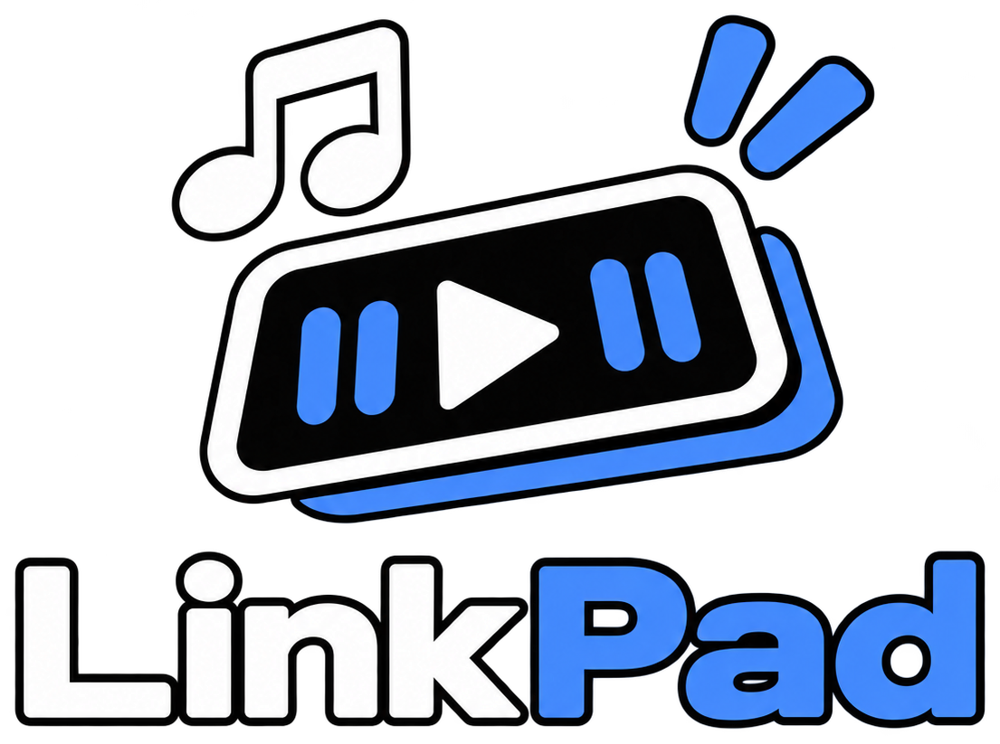

<p align="center">
  <picture>
    <source media="(prefers-color-scheme: dark)" srcset="linkpad/assets/logo-on-dark.png">
    
  </picture>
</p>

<p align="center"><a href="README.th.md">ภาษาไทย</a> · English</p>

**A soundboard that plays audio straight from links — no pre-made sound library needed.**
Paste a YouTube or TikTok link (or pick a local file) and LinkPad plays it into a *virtual microphone*,
so your friends hear it in **Discord** and **games**.

<!-- TODO: add a screenshot at docs/screenshot.png and uncomment:

-->

## Features

- **Link to sound:** paste a link, the audio is downloaded once and kept in your library (works offline afterwards)
- **Supported sources:** YouTube, TikTok (full and `vm.tiktok.com` short links), local audio/video files
  (mp3, wav, ogg, m4a, flac, aac, opus, webm, mp4, mkv). Other sites supported by
  [yt-dlp](https://github.com/yt-dlp/yt-dlp) (e.g. SoundCloud) may work but are not guaranteed
- **Playback modes:** play once · repeat one track · play the whole library · repeat the whole library
- **Library:** rename tracks (✎ or right-click), delete, previous/next
- **Live controls:** volume (0–500 %), speed (0.5×–2×), bass boost, "Earrape" mode, seek bar, elapsed / total time
- **Two outputs at once:** virtual mic for your friends + headphones so you hear it too
- **Thai / English interface:** switch language with the button at the top right (your choice is remembered)
- **Global hotkeys** (work while you are in a game): `F7` previous · `F8` play/pause · `F9` stop · `F10` next

## How it works

```
YouTube / TikTok / file ──► yt-dlp + ffmpeg ──► LinkPad ──► CABLE Input ──► CABLE Output ──► Discord / game (as "mic")
                                                       └──► your headphones (optional monitor)
```

LinkPad does not hook into Discord or games. It plays sound into a virtual audio cable
(e.g. [VB-CABLE](https://vb-audio.com/Cable/)), and you select the other end of the cable as your microphone.

## Requirements

- Python 3.9+
- A virtual audio cable. **Windows:** [VB-CABLE](https://vb-audio.com/Cable/) (free)
- Windows is the primary target. macOS/Linux are untested (you would need a virtual device such as BlackHole or a PulseAudio null sink; global hotkeys need root on Linux)

## Install & run

```bash
git clone https://github.com/THATTHEP-LOLSUS/linkpad.git
cd linkpad
python -m pip install -r requirements.txt
python -m linkpad
```

On Windows you can also double-click `setup.bat` (install) and `run.bat` (start).
ffmpeg is bundled through `imageio-ffmpeg`, nothing else to install.

## Setup (one time)

1. Install **VB-CABLE** and reboot.
2. In LinkPad: **Send to** = `CABLE Input`, **Monitor** = your headphones/speakers (or *off*).
3. In Discord / your game: set the **input device (microphone)** to `CABLE Output`.
4. In Discord → Voice & Video: turn **off** Noise Suppression, Echo Cancellation and Automatic Gain Control,
   and lower Input Sensitivity (or use Push-to-Talk). Otherwise music gets filtered out.
5. To talk *and* play sounds at the same time, mix your real mic with the cable using [VoiceMeeter](https://vb-audio.com/Voicemeeter/).

## Usage

1. Paste a link and press **Enter** (or **Add + play**), or click **Add file**.
2. Click a track to play it. Pick a playback mode with the selector under the transport buttons.
3. Rename a track with ✎ or right-click; remove it with ✕.

Speed works like a tape: faster also means higher pitch.

## Where is my data?

Library and downloaded audio are stored in `%APPDATA%\LinkPad` (Windows) or `~/.config/LinkPad`.
Your language choice is saved there too (`settings.json`). Set the `LINKPAD_HOME` environment variable to use another folder. Removing a track also deletes its cached file
(files you added from your own disk are never touched).
A track is decoded into memory when played (about 11 MB per minute), so very long videos use a lot of RAM.

## Project structure

```
linkpad/
├── linkpad/
│   ├── __main__.py    # entry point (python -m linkpad)
│   ├── gui.py         # window, library list, controls (customtkinter)
│   ├── audio.py       # playback engine: devices, speed, volume, bass
│   ├── media.py       # yt-dlp download + ffmpeg decode, error messages
│   ├── library.py     # saved tracks (JSON), rename/remove
│   ├── playlist.py    # play-mode logic (what plays next)
│   ├── i18n.py        # Thai / English UI strings
│   ├── config.py      # constants, data folders, saved settings
│   └── assets/        # logo and window icon
├── tests/             # unit tests (no sound card needed)
├── .github/workflows/tests.yml
├── requirements.txt · pyproject.toml · run.bat · setup.bat
└── README.md · README.th.md · LICENSE
```

## Development

```bash
python -m pip install numpy scipy
python -m unittest discover -s tests -v
```

## Troubleshooting

| Problem | Try |
|---|---|
| TikTok / YouTube link fails | `python -m pip install -U yt-dlp` (sites change often) |
| Link is private or needs login | Not supported |
| Friends hear nothing | Is Discord's input `CABLE Output`? Are noise suppression / AGC off? |
| No sound at all in LinkPad | Pick your headphones in **Monitor**; check the volume slider |
| "VB-CABLE not found" message | Install VB-CABLE and reboot |

## About this project / AI-assisted development

This project was **developed together with an AI assistant ([Claude](https://www.anthropic.com/claude), made by Anthropic)**,
not written entirely by hand. The author came up with the idea, described what the app should do, ran it and reported
problems; most of the code, tests and documentation were written by Claude in that back-and-forth.

The automated tests cover the logic (library, play modes, audio maths) but not every real-world setup
(different sound cards, Discord/game versions, site changes at YouTube/TikTok). Please review the code before relying on it,
and open an issue if something breaks.

## Disclaimer

LinkPad downloads audio from links you provide, for personal use. You are responsible for respecting the
terms of service of each platform and applicable copyright law. Loud/Earrape playback can damage hearing
and annoy others — use it responsibly.

## License

[MIT](LICENSE) © 2026 THATTHEP-LOLSUS
